# SeguridadAPI — Secure Task Manager (Node.js + Flutter)

Implementación completa del tutorial **"Full-Stack Tutorial: Secure Task Manager with Flutter and Node.js"**: una app de tareas con registro, inicio de sesión y CRUD de tareas, donde un cliente **Flutter** consume una **API REST versionada** hecha con **Node.js, Express, PostgreSQL y Prisma**, con rotación de refresh tokens, detección de reuso y cierre de sesión en el servidor.

> **Aviso:** es un proyecto de aprendizaje, no una auditoría de seguridad para producción.

<p align="center">
  
  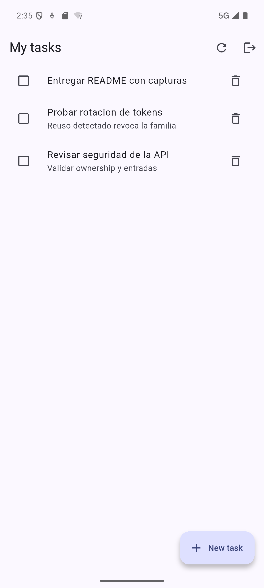
  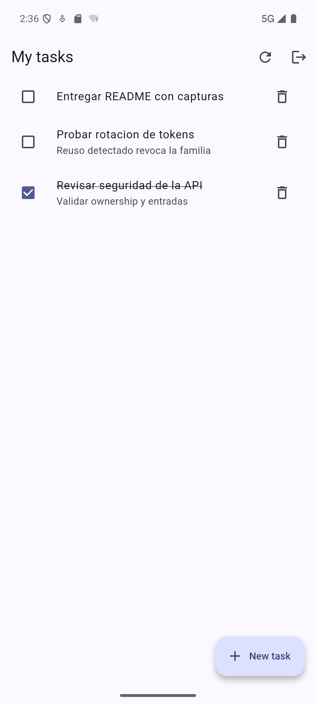
  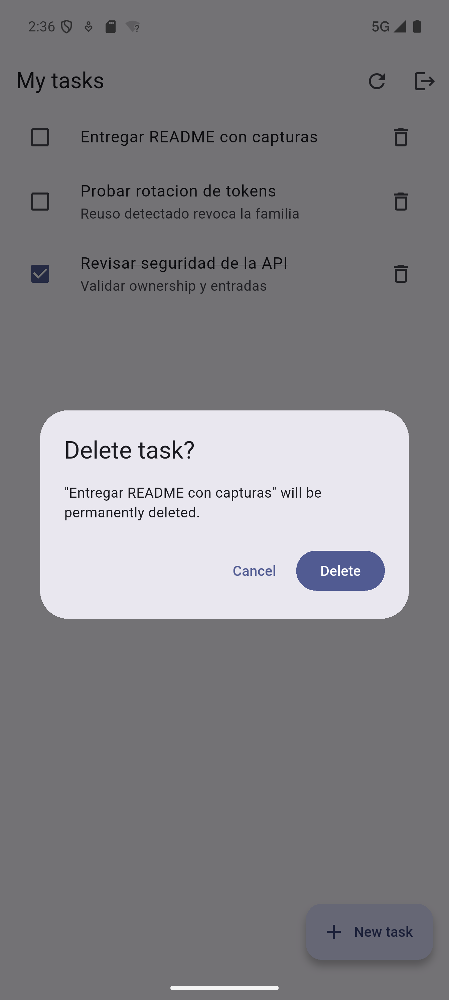
</p>

---

## Índice

1. [Objetivos de aprendizaje](#objetivos-de-aprendizaje)
2. [Arquitectura](#arquitectura)
3. [Tecnologías y versiones](#tecnologías-y-versiones)
4. [Estructura del repositorio](#estructura-del-repositorio)
5. [Desarrollo paso a paso](#desarrollo-paso-a-paso)
6. [Cómo ejecutar el proyecto](#cómo-ejecutar-el-proyecto)
7. [Endpoints de la API](#endpoints-de-la-api)
8. [Evidencias de ejecución](#evidencias-de-ejecución)
9. [Ejercicio 19a — resultados](#ejercicio-19a--resultados)
10. [Pruebas automatizadas](#pruebas-automatizadas)
11. [Checklist de seguridad](#checklist-de-seguridad)
12. [Cambios respecto al tutorial y por qué](#cambios-respecto-al-tutorial-y-por-qué)
13. [Problemas encontrados y solución](#problemas-encontrados-y-solución)
14. [Reflexión](#reflexión)
15. [Retos de extensión](#retos-de-extensión)
16. [Referencias](#referencias)

---

## Objetivos de aprendizaje

- [x] Construir y ejecutar una API REST con datos persistentes en PostgreSQL.
- [x] Implementar rotación de refresh tokens, detección de reuso y logout.
- [x] Separar rutas, controladores, servicios y repositorios.
- [x] Autenticar usuarios y autorizar acceso **solo a sus propias tareas**.
- [x] Conectar una app Flutter a la API usando el patrón repositorio.
- [x] Manejar estados de carga, vacío, error y éxito.
- [x] Probar las rutas del backend y el comportamiento del cliente Flutter.

## Arquitectura

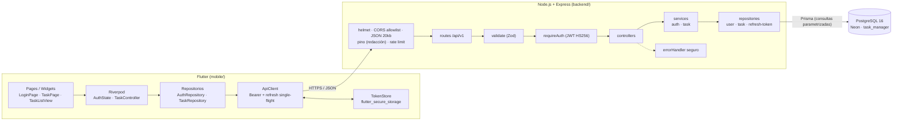

La API **no confía** en la entrada del cliente ni en IDs de usuario enviados por él: la identidad sale únicamente del access token verificado y **toda consulta de tareas filtra por `ownerId` = usuario autenticado**.

### Rotación, detección de reuso y logout

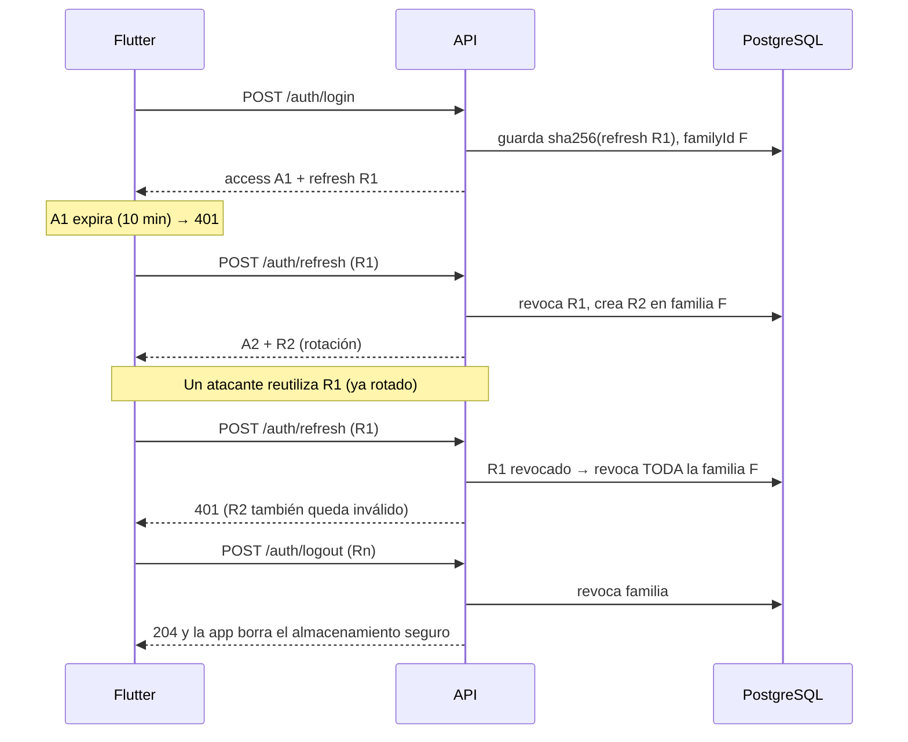

## Tecnologías y versiones

| Capa | Tecnología |
|---|---|
| Runtime | Node.js 24.12 · npm 11.13 |
| API | Express 5.3 · helmet 8 · cors · express-rate-limit 8 · zod 4 · pino / pino-http |
| Auth | bcrypt (costo 12) · jsonwebtoken (HS256, 10 min) · refresh tokens opacos (48 bytes, SHA-256 en BD, 7 días) |
| Base de datos | PostgreSQL 16 en **Neon** · Prisma ORM 6.19 |
| Pruebas backend | Jest 30 · Supertest 7 |
| Móvil | Flutter 3.47 / Dart 3.13 · flutter_riverpod 3 · http · flutter_secure_storage 11 · mocktail |
| Emulador | Android Pixel 9 Pro XL, API 36 |

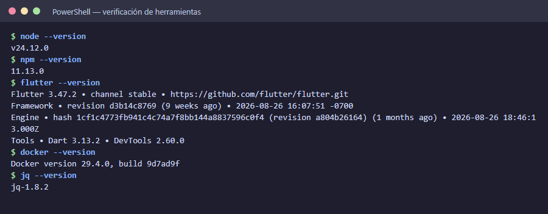

## Estructura del repositorio

```
SeguridadAPI/
├── backend/
│   ├── compose.yaml              # PostgreSQL 16 local con Docker (opción del tutorial)
│   ├── .env.example              # plantilla SIN secretos (el .env real está en .gitignore)
│   ├── docs/openapi.yaml         # contrato OpenAPI 3.0.3 completo
│   ├── prisma/
│   │   ├── schema.prisma         # User · Task · RefreshToken
│   │   └── migrations/           # migración init
│   ├── scripts/
│   │   ├── token-exercise.sh     # ejercicio 19a automatizado (no imprime tokens)
│   │   ├── security-demo.sh      # headers, validación, IDOR, errores seguros
│   │   └── inspect-tokens.js     # inspección de RefreshToken sin tokenHash
│   ├── src/
│   │   ├── app.js · server.js · config.js
│   │   ├── routes/        auth.routes.js · task.routes.js
│   │   ├── controllers/   auth.controller.js · task.controller.js
│   │   ├── services/      auth.service.js · task.service.js
│   │   ├── repositories/  user · task · refresh-token
│   │   ├── middleware/    auth · error · validate
│   │   ├── schemas/       auth.schema.js · task.schema.js
│   │   └── utils/tokens.js
│   └── tests/             health · auth-tasks · refresh
├── mobile/
│   ├── lib/
│   │   ├── main.dart
│   │   ├── core/
│   │   │   ├── config/app_config.dart
│   │   │   ├── network/api_client.dart
│   │   │   ├── storage/token_store.dart
│   │   │   └── providers.dart
│   │   └── features/
│   │       ├── auth/  data/auth_repository.dart · presentation/login_page.dart
│   │       └── tasks/ data/task_repository.dart · domain/task.dart
│   │                  presentation/task_controller.dart · task_page.dart · task_list_view.dart
│   ├── android/app/src/debug/res/xml/network_security_config.xml  # HTTP solo a 10.0.2.2 y solo en debug
│   └── test/              api_client_test · task_list_view_test · fake_token_store
└── docs/images/           capturas usadas en este README
```

## Desarrollo paso a paso

Cada sección del tutorial y lo que se hizo:

| # | Paso del tutorial | Implementación |
|---|---|---|
| 1 | Instalar herramientas y crear el proyecto | `backend/` + `flutter create mobile` |
| 2 | PostgreSQL con Docker Compose | `backend/compose.yaml` idéntico al tutorial, probado con `docker compose up -d` (contenedor *healthy*, migración aplicada y 14/14 tests). Para el día a día se usó **PostgreSQL 16 en Neon** con la misma base `task_manager` y el mismo rol `app_user`, porque Docker Desktop falló varias veces en este equipo (ver [problemas](#problemas-encontrados-y-solución)) |
| 3 | Backend Node.js | dependencias, scripts `dev/start/test/db:*` y estructura por capas |
| 4 | Secretos locales | `.gitignore` con `.env`; `.env.example` solo con placeholders; secretos JWT de 64 caracteres aleatorios con `crypto.randomBytes(48)`; `config.js` valida el entorno con Zod (mínimo 32 caracteres) |
| 5 | Esquema de BD | `User`, `Task`, `RefreshToken` con índices y `onDelete: Cascade`; `prisma migrate dev --name init` |
| 6 | Validación | Zod para body, query y **params** (IDs) + middleware `validate` |
| 7 | Hash y tokens | bcrypt costo 12; JWT HS256 de 10 min con `iss`/`aud`/`type`; refresh opaco de 48 bytes, solo se guarda su SHA-256 |
| 8 | App y defaults seguros | `x-powered-by` deshabilitado, helmet, body ≤ 20 kb, CORS con allowlist, pino con redacción de `authorization`, `password` y `refreshToken` |
| 9 | Manejo central de errores | Nunca devuelve stack, SQL ni mensajes internos (500 → mensaje genérico) |
| 10 | Repositorios y ownership | `findFirst/updateMany/deleteMany` con `{ id, ownerId }` → evita IDOR |
| 11 | Auth y rutas protegidas | register, login (hash señuelo contra enumeración), refresh transaccional con detección de reuso, logout, logout-all; rate limit 10/30 por 15 min |
| 12 | Contrato API | [`backend/docs/openapi.yaml`](backend/docs/openapi.yaml) completo (todas las rutas, esquemas y errores) |
| 13 | Servidor y apagado ordenado | `SIGTERM/SIGINT` → cierra HTTP y desconecta Prisma |
| 14–18 | Cliente Flutter | config por `--dart-define`, modelo `Task`, `TokenStore` seguro, `ApiClient` con refresh single-flight y un solo reintento, repositorios, Riverpod, login/registro, lista con estados, confirmación al borrar, logout en el AppBar |
| 19 | Verificación end-to-end | curl + app en emulador Android (capturas abajo) |
| 19a | Ejercicio práctico | [`backend/scripts/token-exercise.sh`](backend/scripts/token-exercise.sh): todos los resultados coinciden con lo esperado |
| 20 | Pruebas | 14 pruebas Jest/Supertest + 12 pruebas Flutter, todas pasando |

## Cómo ejecutar el proyecto

### Requisitos

Node.js LTS, Flutter SDK, Android Studio con un emulador, `jq` y una base PostgreSQL 16 (Docker **o** Neon).

### 1. Base de datos

**Opción A: Docker (como el tutorial)**

```bash
cd backend
docker compose up -d
```

**Opción B: Neon (la usada en este proyecto)**: crea un proyecto PostgreSQL 16 con la base `task_manager` y copia su cadena de conexión **directa** (sin `-pooler`) en `DATABASE_URL`, agregando `sslmode=require&connect_timeout=30`.

### 2. Backend

```bash
cd backend
npm install
cp .env.example .env
```

Reemplaza en `.env` los placeholders `JWT_ACCESS_SECRET` / `JWT_REFRESH_SECRET` por valores aleatorios largos, por ejemplo:

```bash
node -e "console.log(require('crypto').randomBytes(48).toString('base64url'))"
```

```bash
npx prisma migrate dev
npm run dev
```

```bash
curl http://localhost:3000/health
```

### 3. App Flutter (emulador Android)

```bash
cd mobile
flutter pub get
flutter run --dart-define=API_BASE_URL=http://10.0.2.2:3000/api/v1
```

`10.0.2.2` es el alias del emulador para el `localhost` de la computadora. El HTTP sin cifrar solo está permitido hacia ese host y solo en builds **debug** (`android/app/src/debug/res/xml/network_security_config.xml`); los builds release bloquean el texto plano.

### 4. Pruebas

```bash
cd backend && npm test
```

```bash
cd mobile && flutter test
```

## Endpoints de la API

Base: `http://localhost:3000/api/v1` · contrato completo en [`backend/docs/openapi.yaml`](backend/docs/openapi.yaml)

| Método | Ruta | Auth | Rate limit | Respuestas |
|---|---|---|---|---|
| GET | `/health` (sin prefijo) | — | — | 200 |
| POST | `/auth/register` | — | 10 / 15 min | 201 · 400 · 409 · 429 |
| POST | `/auth/login` | — | 10 / 15 min | 200 · 400 · 401 · 429 |
| POST | `/auth/refresh` | — | 30 / 15 min | 200 · 400 · 401 · 429 |
| POST | `/auth/logout` | — | 30 / 15 min | 204 · 400 |
| POST | `/auth/logout-all` | Bearer | — | 204 · 401 |
| GET | `/tasks?page=&limit=` | Bearer | — | 200 · 400 · 401 |
| POST | `/tasks` | Bearer | — | 201 · 400 · 401 |
| PATCH | `/tasks/:taskId` | Bearer | — | 200 · 400 · 401 · 404 |
| DELETE | `/tasks/:taskId` | Bearer | — | 204 · 400 · 401 · 404 |

Todos los errores tienen la misma forma: `{ "error": { "code", "message", "details?" } }`.

## Evidencias de ejecución

### PostgreSQL con Docker Compose (paso 2 del tutorial)

`docker compose up -d` levanta `postgres:16` con *healthcheck*, se aplica la migración y la suite completa pasa contra ese contenedor. Como el puerto 5432 del equipo ya lo ocupa un PostgreSQL de Windows, para esta prueba se publicó en el 5433 con un override temporal; el `compose.yaml` del repo es idéntico al del tutorial.

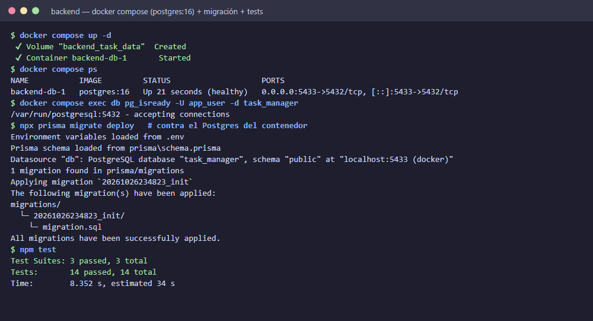

### Base de datos en Neon (PostgreSQL 16)

Tablas creadas por la migración, tareas con su `ownerId` y contraseñas guardadas **solo como hash bcrypt**:

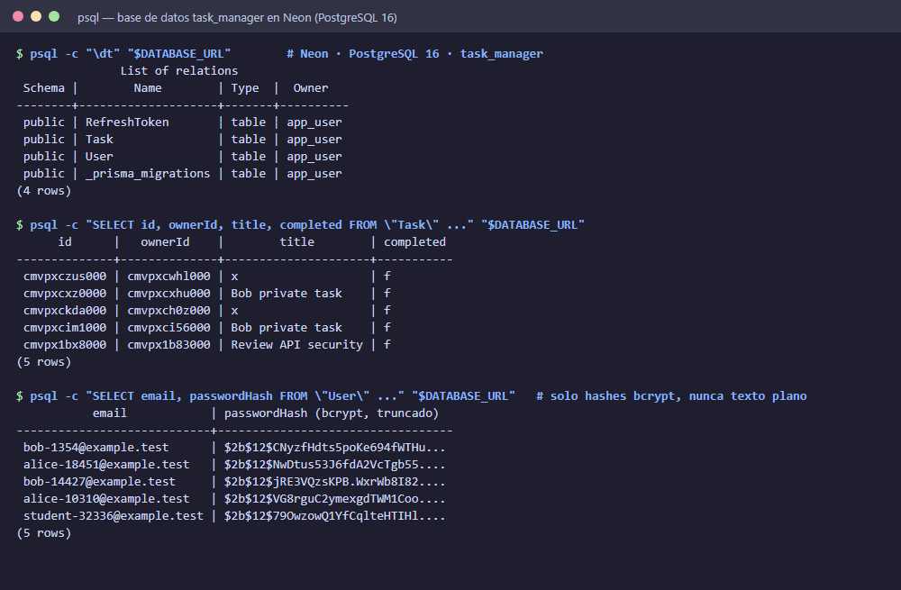

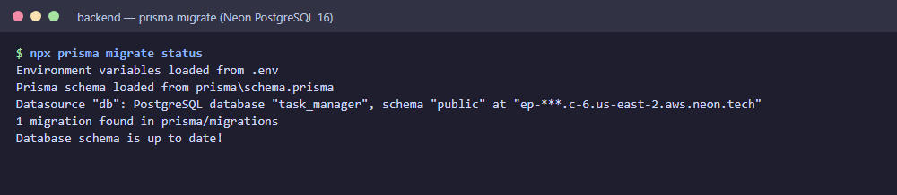

### API corriendo

Los logs de `pino-http` solo registran método, URL y estatus. Nunca registran headers `Authorization`, contraseñas ni tokens:

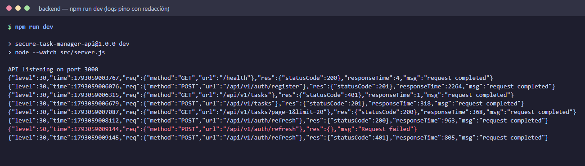

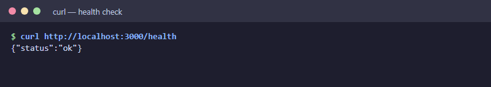

### Comportamiento de seguridad

Headers de helmet, validación con Zod, intento de IDOR (Alice no puede ver, editar ni borrar la tarea de Bob → 404), `ownerId` falsificado ignorado, ID malformado → 400, token falsificado → 401 y origen CORS no permitido → 403:

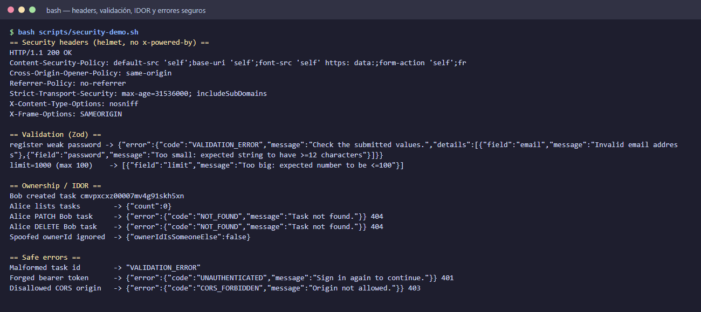

**Rate limiting** en `/auth/login`: después de 10 intentos en 15 minutos responde `429 RATE_LIMITED` con los headers estándar `RateLimit`, `RateLimit-Policy` y `Retry-After`:

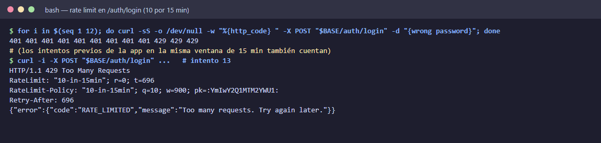

### Refresh tokens en la base de datos

Consulta **sin `tokenHash`**. Se ve cómo los tokens rotados comparten `familyId` y quedan con `revokedAt`:

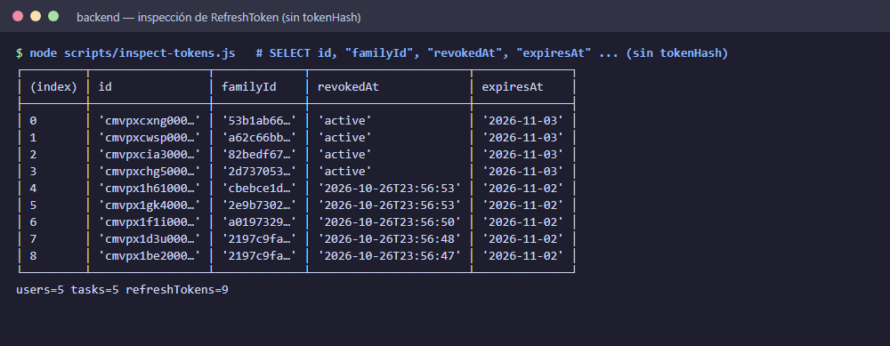

### App Flutter en el emulador

| Inicio de sesión | Registro | Validación del formulario | Credenciales incorrectas |
|---|---|---|---|
|  | 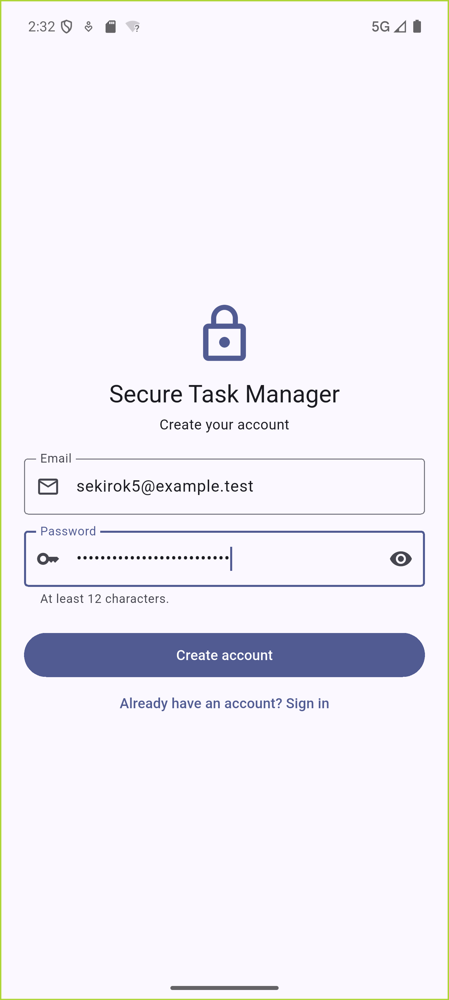 | 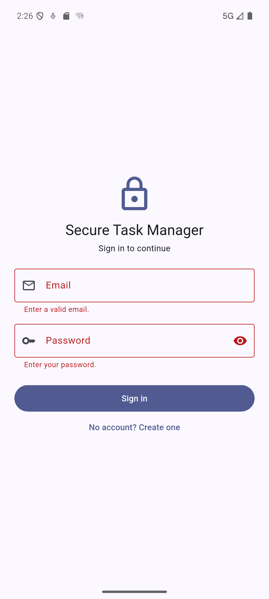 | 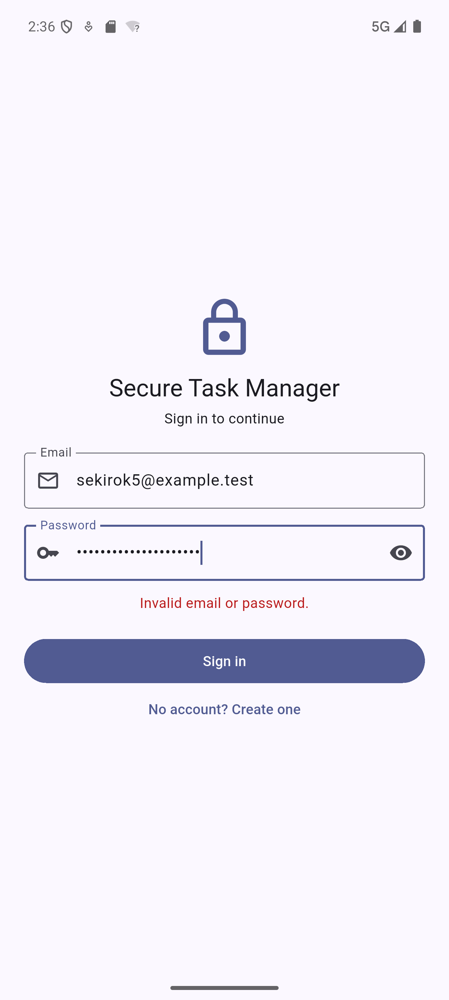 |

| Lista vacía | Nueva tarea | Lista de tareas | Tarea completada |
|---|---|---|---|
| 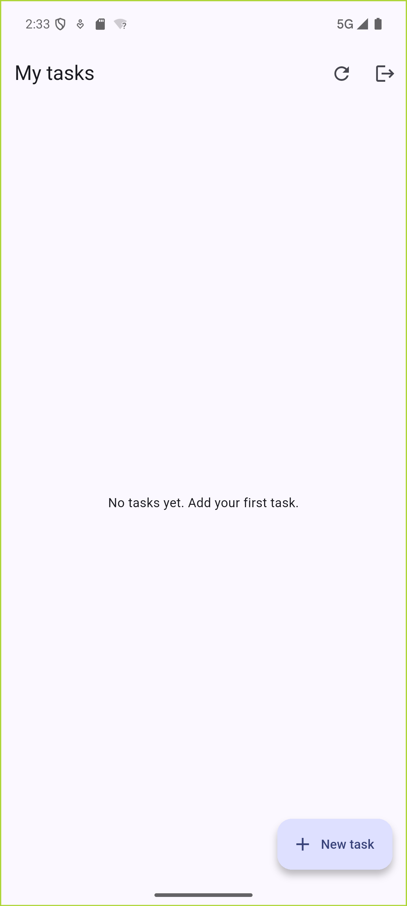 | 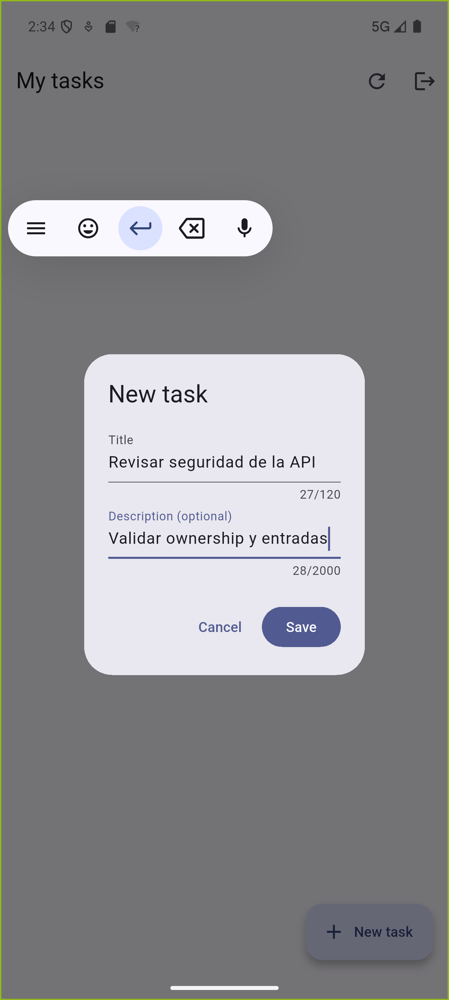 |  |  |

| Confirmar borrado | Logout → login | Datos persistidos al volver a entrar | Error de conexión seguro |
|---|---|---|---|
|  | 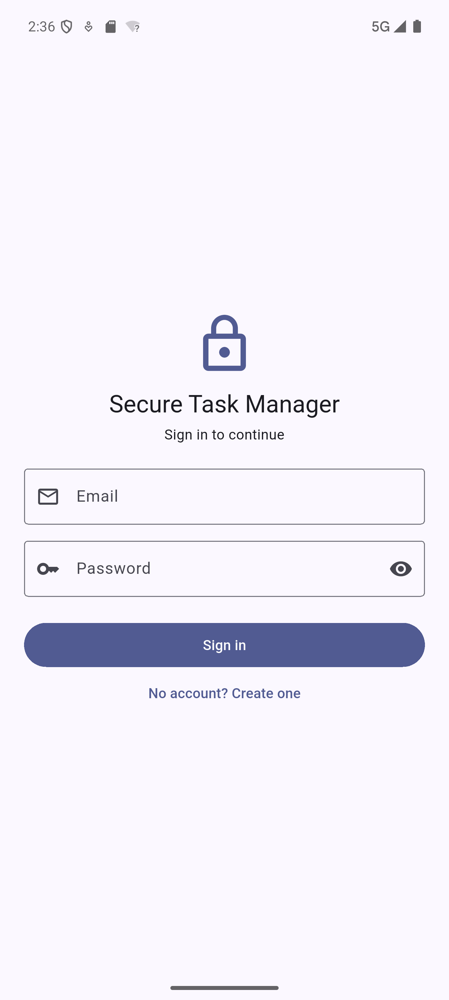 | 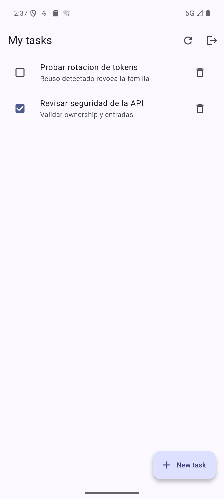 | 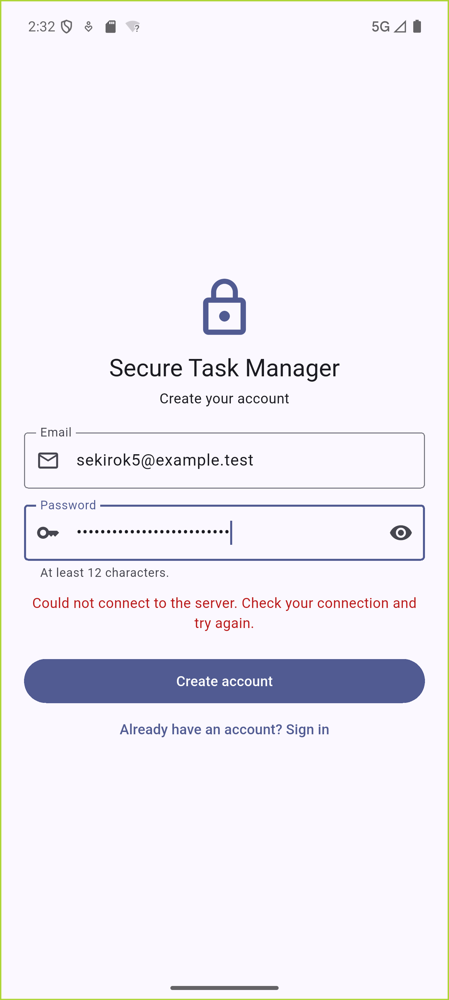 |

**Revocación desde el servidor (Flutter app check del tutorial).** Con la app abierta se ejecutó `logout-all` para la misma cuenta. Cuando expiró el access token de 10 minutos, la siguiente petición de la app recibió 401. El `ApiClient` hizo un único refresh, que también respondió 401 porque la familia estaba revocada. Entonces borró el almacenamiento seguro y la app regresó sola al login:

| `logout-all` desde la terminal | La app regresa al login |
|---|---|
| 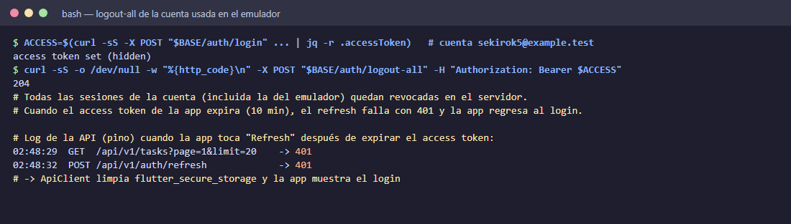 |  |

## Ejercicio 19a — resultados

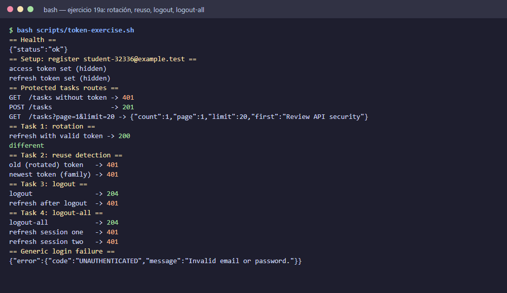

| Prueba | Estatus esperado | Resultado | ¿Pasa? |
|---|---|---|---|
| Refresh con token válido | 200 | 200 (token nuevo: `different`) | ✅ |
| Refresh con token viejo (ya rotado) | 401 | 401 | ✅ |
| Refresh con el token más nuevo tras el reuso | 401 | 401 | ✅ |
| Refresh después de logout | 401 | 401 (logout → 204) | ✅ |
| Refresh después de logout-all (2 sesiones) | 401 | 401 y 401 (logout-all → 204) | ✅ |

**Verificación en la app:** con sesión iniciada en el emulador se ejecutó `logout-all` con curl para esa cuenta. En la siguiente petición, el `ApiClient` intentó un refresh, recibió 401, limpió el almacenamiento seguro y regresó a la pantalla de login.

## Pruebas automatizadas

### Backend: 14 pruebas (Jest + Supertest contra la BD real)

Cubren registro, credenciales incorrectas con respuesta genérica idéntica, entrada inválida, falta de token o token falsificado, CRUD propio, límites de paginación, `ownerId` ignorado, **IDOR entre usuarios**, IDs malformados sin filtrar detalles, rotación, reuso, logout y logout-all.

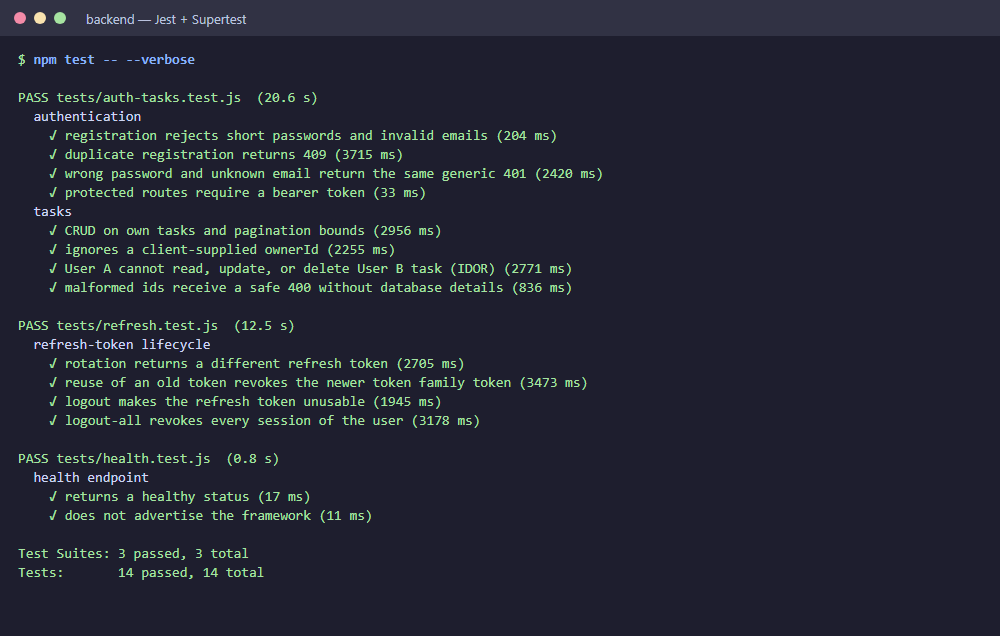

### Flutter: 12 pruebas

`ApiClient` (un solo refresh y un solo reintento con `MockClient`; refresh fallido que limpia tokens; *single-flight* con peticiones concurrentes; errores sin tokens ni cuerpos crudos; timeouts), `TaskRepository` (parseo, lista vacía, nunca envía `ownerId`, conserva el query string) y widget tests de los estados de carga, vacío, error y lista.

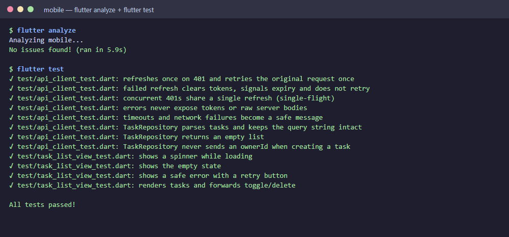

## Checklist de seguridad

| Práctica | Por qué importa | Cómo se cumple aquí |
|---|---|---|
| Autorización a nivel de objeto | Evita IDOR | Toda consulta filtra por `{ id, ownerId }` del token; test de IDOR |
| Access tokens cortos + rotación | Limita tokens robados | JWT de 10 min; refresh rotado en cada uso, revocado al reusar |
| Hash fuerte de contraseñas | Protege credenciales | bcrypt costo 12; hash señuelo para igualar tiempos |
| Validación y payload acotado | Entrada maliciosa / abuso | Zod en body, query y params; `express.json({ limit: '20kb' })` |
| Rate limit en auth | Fuerza bruta | 10 req / 15 min en login y registro; 30 en refresh y logout |
| Errores seguros | No filtrar internos | `errorHandler` central; 500 → mensaje genérico |
| HTTPS en despliegue | Datos en tránsito | HTTP solo en debug hacia 10.0.2.2; HSTS por helmet |
| CORS con allowlist | Limita orígenes de navegador | `CORS_ORIGINS` explícito; origen no permitido → 403 |
| Secretos y redacción de logs | Fugas accidentales | `.env` en `.gitignore`; pino redacta auth, contraseñas y tokens |
| Paginación con límites | Exposición de datos | `limit` ≤ 100 |
| Revisión de dependencias | Cadena de suministro | `npm audit` → 0 vulnerabilidades |
| Tests de límites de autorización | Detecta control de acceso roto | Tests de CRUD entre usuarios |
| Rotación y reuso de refresh | Valor de un refresh robado | SHA-256 en BD, familia revocada al reusar |
| Logout y revocación | Cierra sesiones en el servidor | logout (familia), logout-all, la app limpia el almacenamiento seguro |

Se relaciona con el **OWASP API Security Top 10**: autorización rota a nivel de objeto (API1), autenticación rota (API2), consumo de recursos sin restricción (API4) y mala configuración de seguridad (API8).

## Cambios respecto al tutorial y por qué

El código sigue el documento casi línea por línea. Estas son las únicas diferencias, todas justificadas:

1. **Neon además de Docker.** El `compose.yaml` está incluido tal cual y se probó, pero el desarrollo se hizo contra Neon porque Docker Desktop fallaba en este Windows (ver abajo). Neon es PostgreSQL 16 real con la misma base y el mismo rol; el backend no cambia, solo `DATABASE_URL`.
2. **Prisma 6 fijado.** `npm install prisma` instala Prisma 7+, que ya no acepta `url = env("DATABASE_URL")` dentro de `schema.prisma` (el formato que usa el tutorial). Con Prisma 6 el esquema funciona sin cambios.
3. **Express 5 y `req.query`.** En Express 5, `req.query` es un *getter*, así que `req[key] = parsed.data` truena. El middleware usa `Object.defineProperty`.
4. **Capa de controladores.** El tutorial lista `controllers/` en la estructura, pero pone la lógica en las rutas; aquí las rutas delegan en `auth.controller.js` y `task.controller.js`. También se agregó `user.repository.js`, que estaba en la estructura.
5. **Validación de `:taskId`.** El tutorial pide *"Add parameter validation for route IDs"*: se valida el formato cuid con Zod (ID malformado → 400).
6. **CORS → 403.** El error de origen no permitido no tenía estatus y salía como 500 genérico; ahora es `403 CORS_FORBIDDEN`.
7. **`ApiClient` y query strings.** `base.replace(path: '.../tasks?page=1&limit=20')` codificaba el `?` como `%3F`; ahora el path y el query se separan. Además, los 401/409/429 de auth muestran mensajes útiles y seguros.
8. **Tests con timeout de 30 s** por la latencia de bcrypt (costo 12) más la red hacia Neon, y rate limiting desactivado solo cuando `NODE_ENV=test`.

## Problemas encontrados y solución

| Problema | Causa | Solución |
|---|---|---|
| Docker Desktop se cierra: *"initializing Inference manager … dockerInference: The file cannot be accessed by the system"* | La build de Windows (Insider 26300) no permite recrear sockets Unix (AF_UNIX) que Docker usa internamente | Se intentó mover la carpeta de sockets y desactivar funciones de IA; al no funcionar, se usó Neon |
| Gradle: *"Unable to establish loopback connection"* | El mismo bug de sockets AF_UNIX (Java los usa para sus pipes internos) | `JAVA_TOOL_OPTIONS=-Djdk.net.unixdomain.tmpdir=C:\tmp\uds` |
| *"NDK … did not have a source.properties file"* | Descarga del NDK incompleta o corrupta | Descargar `android-ndk-r28c-windows.zip` directo de `dl.google.com`, verificarlo con `unzip -t` y extraerlo en `Sdk/ndk/28.2.13676358` |
| *"Recursos insuficientes en el sistema"* / el daemon de Gradle se cae | La plantilla de Flutter pone `-Xmx8G` y el equipo tiene 7.3 GB de RAM (más el emulador) | `org.gradle.jvmargs=-Xmx2G` en `android/gradle.properties` y compilar el APK con el emulador apagado |
| `"C:\Users\Noe" no se reconoce como un comando` | El SDK de Flutter está en una ruta con espacio y un *build hook* no la pone entre comillas | Junction sin espacios `C:\flutter` → SDK, y `flutter.sdk=C:\\flutter` en `android/local.properties` (archivo local, no se sube) |
| Docker Desktop: *"Secrets Engine … engine.sock"* | Mismo bug de sockets | Limpiar `%LOCALAPPDATA%\Docker\run` y `%LOCALAPPDATA%\docker-secrets-engine` con WSL apagado; después Docker arrancó |
| `Can't reach database server` intermitente | Arranque en frío del cómputo de Neon | `connect_timeout=30&pool_timeout=30` en `DATABASE_URL` |
| `prisma migrate` con el host `-pooler` | PgBouncer no soporta las operaciones de migración | Usar el host directo de Neon |

## Reflexión

- **¿Por qué rotar refresh tokens?** Cada token sirve una sola vez. Si alguien roba uno, solo funciona hasta que el usuario legítimo haga refresh, y cualquier reuso queda detectado.
- **¿Qué pasaría si el servidor guardara refresh tokens en crudo?** Una filtración de la BD daría sesiones válidas de todos los usuarios. Con SHA-256 solo se filtran hashes inútiles; como el token tiene 384 bits aleatorios, no hace falta un hash lento.
- **¿Por qué el reuso revoca toda la familia?** El servidor no sabe quién es el legítimo y quién el atacante, así que corta toda la cadena y obliga a iniciar sesión de nuevo.
- **¿Cuál es el costo si un cliente legítimo reintenta un refresh tras un timeout?** Su reintento se ve como reuso y lo desconecta. Por eso el cliente hace *single-flight* (un solo refresh a la vez) y nunca reintenta la llamada de refresh.

## Retos de extensión

- [ ] Eliminación de cuenta y cambio de contraseña con revocación de sesiones
- [ ] Edición completa de tareas (título y descripción) con formulario validado
- [ ] Roles con pruebas de autorización
- [ ] Búsqueda, filtros y paginación estable
- [ ] CI/CD con tests, revisión de dependencias y escaneo de secretos
- [ ] Eventos de auditoría con minimización de datos

## Referencias

- [Node.js](https://nodejs.org/docs/latest/api/) · [Express](https://expressjs.com/) · [PostgreSQL](https://www.postgresql.org/docs/) · [Prisma](https://www.prisma.io/docs) · [Neon](https://neon.com/docs)
- [Flutter](https://docs.flutter.dev/) · [Comentarios de documentación en Dart](https://dart.dev/effective-dart/documentation)
- [OWASP API Security Top 10](https://owasp.org/API-Security/)

---

Autor: **SekiroK5** · Desarrollo Móvil Integral
